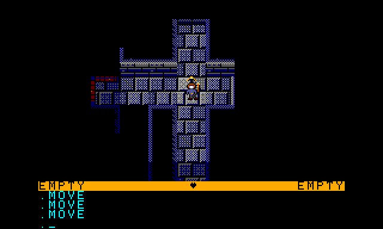
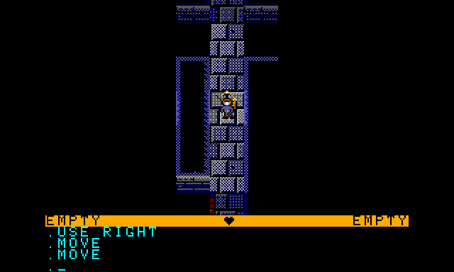
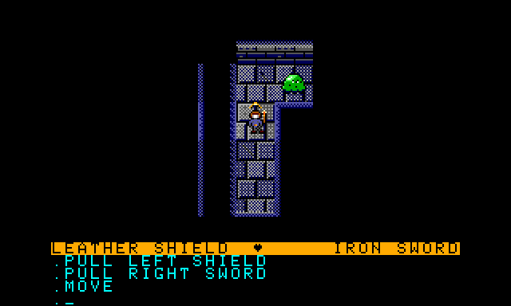
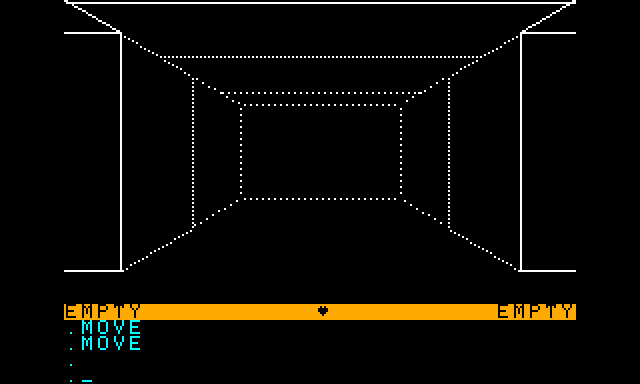
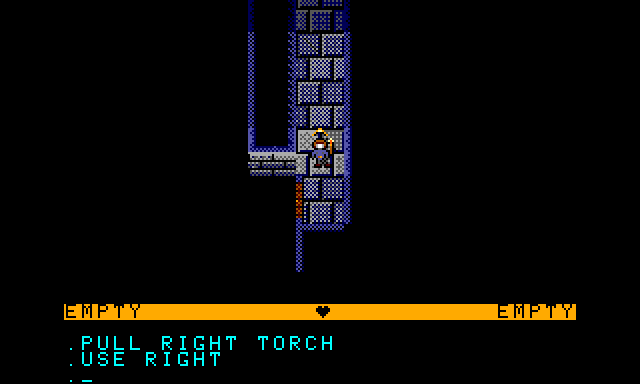

# Dungeons of Daggorath — CoCo 3 Edition

The 1982 DynaMicro classic for the TRS-80 Color Computer, rebuilt for the
**Color Computer 3 with 512K**. It keeps the original game's maze, monsters,
combat and heartbeat, and adds a full-colour **top-down view** that you can
switch to and from the original first-person view at any time.



## New in the CoCo 3 edition

- **Top-down view.** A 320×192, 16-colour map of the dungeon around you, 13×7
  squares, drawn from shaded tiles and sprites held in the extra 512K memory.
- **Switch views with F1.** Press **F1** (or **CLEAR**) to flip between the
  top-down view and the original 3-D wireframe view. The switch is instant,
  and the game remembers your choice when you start a new game.
- **Arrow-key movement.**

  | Key | Does |
  |-----|------|
  | ↑ | `MOVE` (step forward) |
  | ↓ | `MOVE BACK` |
  | ← | `TURN LEFT` |
  | → | `TURN RIGHT` |

  The arrows act when the command line is empty. While you are typing, ← is
  still backspace. Holding an arrow repeats it.
- **Typed commands still work.** `ATTACK`, `PULL`, `USE`, `INCANT`, `CLIMB`
  and the rest are unchanged.
- **Light follows the original rules.** Your torch lights exactly as far as it
  did in the 3-D view, fading with distance. Light stops at walls and closed
  doors.
- **You see in every direction.** Monsters beside and behind you show up if
  they are in your torch light. Monsters outside your line of sight stay
  hidden, and magical ones need magical light, as in the original.
- **Remembered map.** Corridors you have already seen stay on screen in faint
  navy after your torch moves on, so you can find your way back.
- **Doors, secret doors, holes and ladders** are drawn on the map. Secret
  doors only show up under magical light.
- **Status and messages in colour.** The status line is gold and the text
  area is cyan in both views.
- **Same game underneath.** The original 6809 code still runs the maze
  generator, creature AI, combat and timing. Only the drawing is new.

| | |
|---|---|
|  |  |
| Lit corridor, with the remembered map beside you | A blob lurking at the end of a corridor (demo mode) |
|  |  |
| Press F1: the same spot in the original 3-D view | Level 1 start, by pine torch |

## Requirements

- A Color Computer 3 with **512K** RAM and a floppy drive, or an emulator.
  [XRoar](https://www.6809.org.uk/xroar/) 1.10 and MAME's `coco3` driver both
  work.
- An RGB monitor is best (XRoar: `-tv-input rgb`).

## Playing

The disk `build/DOD3.DSK` holds both versions:

```
RUN"DOD"     CoCo 3 edition (top-down + 3-D)
RUN"DOD1"    the original game, unchanged
```

Loading the CoCo 3 edition takes about a minute from floppy because it loads
the tiles and sprites into the upper 512K.

On Windows, `run-xroar.bat` starts XRoar with the right options and runs the
game.

## Building

You need:

- [LWTOOLS](http://www.lwtools.ca/) 4.24 (`lwasm`)
- [ToolShed](https://github.com/nitros9project/toolshed) 2.2 (`decb`)
- Python 3 (to generate the tiles and sprites; Pillow is only needed for `--preview`)

Then run:

```
build.bat
```

Set `LWTOOLS` and `TOOLSHED` if the tools are not in the default
`C:\apps\coco\...` folders. The build produces:

| File | What |
|------|------|
| `build/dod.rom` | The original 8K cartridge image, byte-identical to the 1982 ROM |
| `build/dod3.rom` | The CoCo 3 edition (assembled with `--define=COCO3`) |
| `build/td_blk00-06.bin` | Tiles, sprites and line-of-sight tables for the upper 512K |
| `build/DOD3.DSK` | Disk with both versions |

`python tools/topdown/make_assets.py build --preview` also writes preview
images of the top-down view from a level 1 memory dump.

## How it works

- Every change to the original source is wrapped in `IFDEF COCO3`, so without
  that define the source still builds the original ROM byte for byte.
- `coco3/ENGINE.ASM` sets the GIME to 320×192×16 with two screens, mirrors the
  game's own 1-bit display into colour for the 3-D view, scans the keyboard
  matrix for the arrows and F1, and draws the top-down view.
- The top-down renderer works out line of sight and light for each square,
  then copies pre-shaded 24×24 tiles and masked sprites from 8K blocks that it
  pages into the CPU's address space through the MMU.
- `coco3/DOD3LD.ASM` is the disk loader. It places the asset blocks in the
  upper 512K, then copies the game into the top 16K and starts it.

## Credits

Dungeons of Daggorath © 1982 DynaMicro. The 6809 source in this repository
was reconstructed from the original listing by MichaelSpencerJr and is used
under the copyright owner's grant (see `grant_of_license.png`). The CoCo 3
edition is built on top of it.
